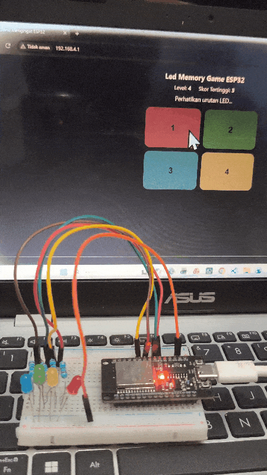

# Led Memory Game ESP32 (LED + Web Lokal)

Game mengingat berbasis **ESP32** dan **4 LED**. ESP32 menyalakan LED dengan urutan acak, lalu pemain mengulang urutan itu lewat **tombol di halaman web lokal**. Makin tinggi level, makin panjang urutan yang harus diingat.

## Demo

| Rangkaian | Gameplay |
|---|---|
|  |  |

*LED menyala sesuai urutan, lalu jawaban ditekan lewat tombol di halaman web.*

## Fitur

- Urutan LED acak, bertambah satu LED setiap naik level
- Kecepatan nyala LED makin cepat di level tinggi
- Tombol input lewat web lokal, tanpa tombol fisik dan tanpa internet
- ESP32 membuat WiFi sendiri (mode hotspot), jadi tidak perlu router
- Menampilkan level saat ini, skor terbaik, dan progres jawaban
- Semua LED berkedip bareng saat game over

## Cara Bermain

1. LED menyala satu per satu sesuai urutan. **Perhatikan dan ingat** urutannya.
2. Tekan tombol di halaman web sesuai urutan LED yang menyala.
3. Jawaban benar berarti naik level dan urutan bertambah. Salah atau tidak menjawab dalam 8 detik berarti game over.

Warna tombol di web mengikuti warna LED di rangkaian, jadi LED merah berarti tekan tombol merah.

## Komponen

| Komponen | Jumlah |
|---|---|
| ESP32 DevKit | 1 |
| LED (merah, hijau, biru, kuning) | 4 |
| Resistor 220Ω | 4 |
| Breadboard + kabel jumper | secukupnya |
| Kabel USB (data) | 1 |

## Wiring

| GPIO ESP32 | LED | Tombol di web |
|---|---|---|
| 16 | Merah | 1 |
| 17 | Hijau | 2 |
| 18 | Biru | 3 |
| 19 | Kuning | 4 |

Setiap LED: `GPIO → resistor 220Ω → anoda (kaki panjang) LED → katoda (kaki pendek) → GND`.
Semua GND LED disatukan dan disambung ke pin GND ESP32.

## Cara Upload

1. Install **Arduino IDE** dan tambahkan board ESP32 (Boards Manager: `esp32` oleh Espressif).
2. Buka file `game_mengingat_esp32_web_tanpa_buzzer.ino`.
3. Pilih board `ESP32 Dev Module` dan port yang sesuai, lalu klik **Upload**.
4. Kalau muncul `Connecting......` dan gagal, tahan tombol **BOOT** di board sampai upload mulai berjalan.

## Cara Menjalankan

1. Nyalakan ESP32. Keempat LED akan berkedip berurutan sekali.
2. Sambungkan HP atau laptop ke WiFi:
   - SSID: `MemoryGame`
   - Password: `12345678`
3. Buka `http://192.168.4.1` di browser (pakai `http://`, bukan `https://`).
4. Tekan **MULAI**.

> Status WiFi akan tertulis "no internet". Itu normal karena ESP32 hanya membuat jaringan lokal.

## Konfigurasi

Semua pengaturan ada di bagian atas file `.ino`:

| Pengaturan | Fungsi |
|---|---|
| `ledPins` | Daftar pin GPIO untuk LED |
| `NUM_LED` | Jumlah LED (ubah juga `const N=4` di bagian JavaScript) |
| `AP_SSID`, `AP_PASS` | Nama dan password WiFi hotspot |
| `USE_AP` | `true` hotspot sendiri, `false` konek ke WiFi rumah |
| `INPUT_TIMEOUT` | Batas waktu tiap jawaban (ms) |
| `MAX_LEVEL` | Level maksimal |

## Troubleshooting

- **Halaman tidak terbuka:** pastikan alamatnya `http://192.168.4.1`, matikan data seluler (di HP), dan coba Incognito atau browser lain. Pastikan IP perangkat berawalan `192.168.4.`
- **Gagal upload (`No serial data received`):** tahan tombol BOOT saat `Connecting......`, ganti kabel USB yang mendukung data, dan turunkan Upload Speed ke 115200.
- **LED tidak menyala:** cek arah LED (kaki panjang ke resistor), sambungan GND, dan nomor pin.
- **Warna tombol tidak cocok dengan LED:** sesuaikan urutan warna di array `COL` pada bagian JavaScript.

## Rencana Pengembangan

- [ ] Menyimpan skor terbaik di memori ESP32
- [ ] Pilihan tingkat kesulitan
- [ ] Tambahan LED (5 atau 6)
- [ ] Menyempurnakan Tampilan Web

## Struktur Repo

```
.
├── game_mengingat_esp32_web_tanpa_buzzer.ino
├── docs/
│   └── wiring.jpg
└── README.md
```

## Lisensi

[Pilih lisensi, misalnya MIT]

## Pembuat

Muhammad Rivan Fathurozin ([@rivanfathur-rgb](https://github.com/rivanfathur-rgb))
